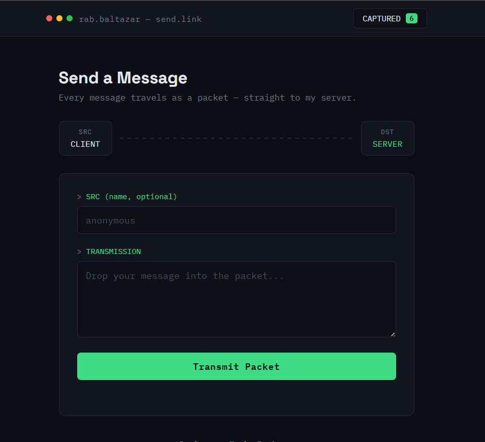
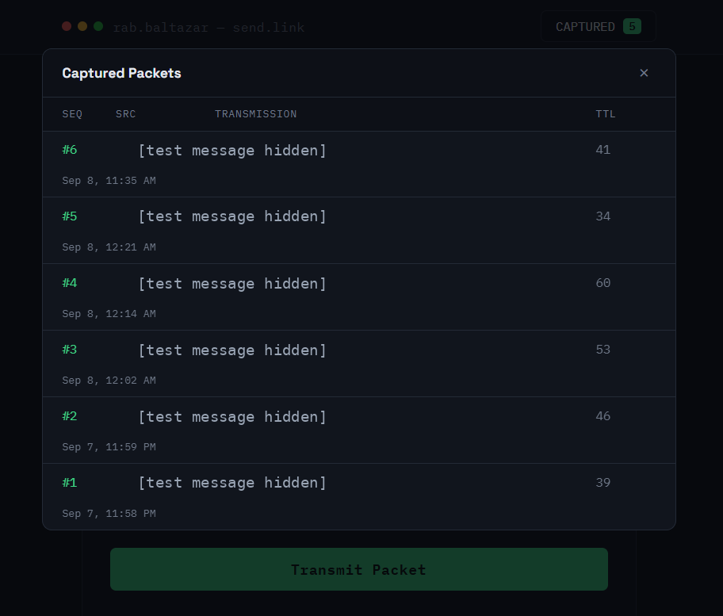
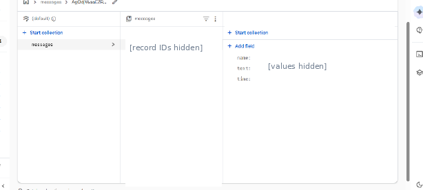

# Firebase and Firestore Messaging Website (Azure VM)

**Platform Technology Activity | September 2026**

## About This Activity

For our Platform Technology subject, I worked on a simple messaging website called **PacketYarn**. I ran the website on an **Azure virtual machine** during the activity, similar to my earlier VM web hosting practical. I also connected the website to **Firebase and Cloud Firestore** so messages could be stored and viewed.

My original documentation focused mostly on the Firebase part, so I didn't take detailed screenshots of the VM setup. However, I was able to access the website using the VM's public IP address during the activity.

## What I Did

- Used an Azure VM to host and access the messaging website during our practical.
- Created a Firebase project and set up a Cloud Firestore database.
- Registered a web app and integrated Firebase into the website.
- Tested the message form and viewed submitted messages in the **Captured Packets** section.
- Checked the message records in Cloud Firestore.

## Tools I Used

- Microsoft Azure Virtual Machines
- Firebase and Cloud Firestore
- HTML, CSS and JavaScript
- Web browser

## Outputs

**Messaging website running during the Azure VM activity**

**Captured messages displayed in the website**

The website uses the word *packet* for its messaging interface. It is **not** a real network packet-capture tool.

**Cloud Firestore records from the original documentation**

## What I Learned

I learned how a simple website can be hosted using a cloud VM and connected to an online database. It also helped me understand how a message entered on a webpage can be displayed in the app and saved in Firestore. I still want to learn more about securing this kind of setup properly.

## Note

This was a **school activity**, not a production application. The Azure VM setup was not documented step by step in my report, and the original temporary cloud resources are no longer running. The screenshots are from the original activity with public IP and message details removed. I have not independently verified production-level security or the final Firestore security rules.
